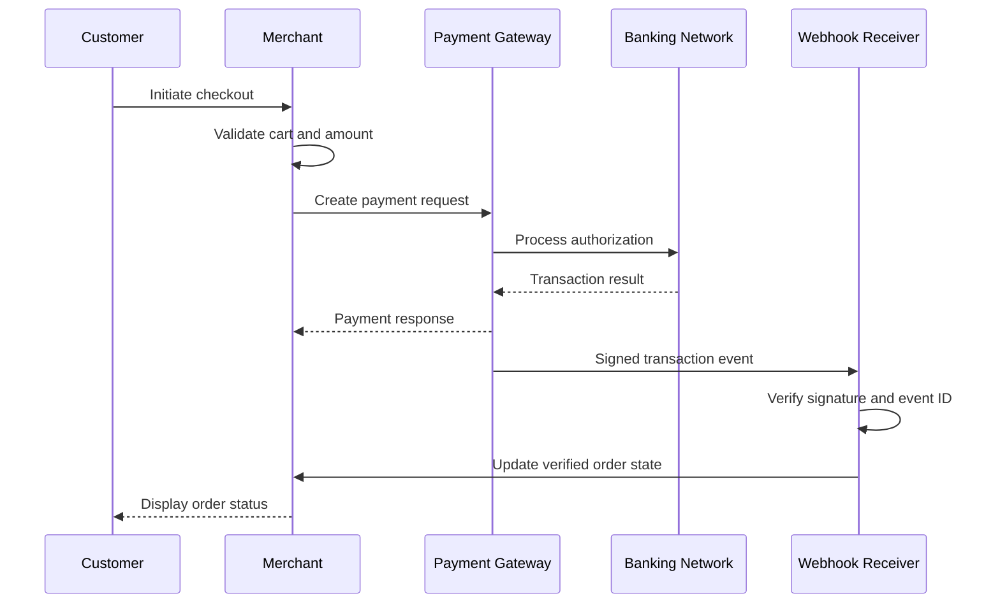
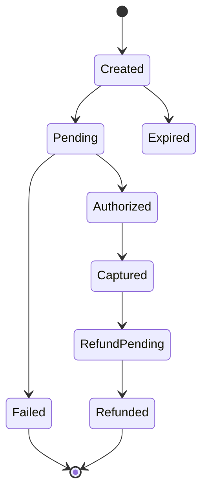

### Payment Gateway Security Research & Authorized Penetration Testing

A Professional GitHub Cybersecurity Research Tutorial

Author: SYLHETYHACKVENGER (THE-ERROR808)

Research focus: Payment gateway architecture, security reconnaissance, attack-surface awareness, API security, transaction integrity, payment-flow auditing, vulnerability assessment, and defensive exploitation analysis.

Payment gateways are among the most security-sensitive components of modern web infrastructure. Their security extends far beyond a checkout page: it involves APIs, merchant integrations, authentication, transaction states, callbacks, webhooks, authorization, cryptographic verification, and third-party dependencies.

An important distinction: researching a payment gateway does not authorize testing someone else's infrastructure. This tutorial focuses on systems you own, explicitly authorized assessments, and payment-provider sandbox environments. I can cover security weaknesses and their defensive validation, but not provide instructions or exploit resources for compromising real payment providers, stealing payment data, or manipulating transactions.

### 1\. Understanding payment gateway architecture


A payment ecosystem typically contains these components:

| Component              | Security responsibility                    |
| ---------------------- | ------------------------------------------ |
| Merchant frontend      | Checkout and customer interaction          |
| Merchant backend       | Order creation and payment verification    |
| Payment API            | Transaction processing                     |
| Authentication service | API credentials and access control         |
| Webhook receiver       | Asynchronous transaction notifications     |
| Acquirer               | Merchant-side payment processing           |
| Issuer                 | Customer's issuing bank                    |
| Transaction database   | Payment and order records                  |
| Risk engine            | Fraud detection and transaction monitoring |
| Reconciliation service | Matching merchant and gateway records      |

### 1.1 The transaction lifecycle



The important research principle is that a successful browser redirect is not proof of successful payment.

The merchant backend must independently verify the transaction with the provider and match:

* Merchant order identifier.

* Gateway transaction identifier.

* Expected amount.

* Currency.

* Merchant account.

* Current transaction status.

* Transaction ownership.

OWASP specifically identifies order manipulation, payment spoofing, callback replay, and business-logic weaknesses as important payment integration risks. OWASP Cheat Sheet Series +1

### 2\. Payment gateway reconnaissance methodology

Reconnaissance should establish an accurate inventory of an authorized payment integration, not discover ways to compromise unrelated financial infrastructure.


### Phase 1 — Scope identification

Establish the following before testing:

* Organization and system owner.

* Written testing authorization.

* Approved domains and subdomains.

* Approved API environments.

* Sandbox versus production boundaries.

* Permitted testing hours.

* Data-handling restrictions.

* Emergency contact.

* Testing exclusions.

* Reporting requirements.

### Phase 2 — Technology fingerprinting

Document publicly disclosed technologies and integration dependencies.

| Research area  | Information to document                |
| -------------- | -------------------------------------- |
| Web server     | Server technology                      |
| Application    | Framework and version                  |
| API            | REST, GraphQL, SOAP                    |
| Authentication | OAuth, API keys, signed requests       |
| Gateway        | Provider and integration type          |
| TLS            | Protocol and certificate configuration |
| Webhooks       | Event types and authentication         |
| SDK            | Official SDK and version               |
| Dependencies   | Libraries and package versions         |
| Infrastructure | CDN, WAF, hosting provider             |

Do not attempt to bypass authentication or access restricted infrastructure during fingerprinting.

### Phase 3 — API surface inventory

Build an inventory using authorized documentation, source code, and sandbox traffic.

Suggested documentation categories:

```text
payment-api-research/
│
├── documentation/
│   ├── api-reference.md
│   ├── authentication.md
│   ├── transaction-lifecycle.md
│   └── provider-integration.md
│
├── architecture/
│   ├── payment-flow.md
│   ├── trust-boundaries.md
│   └── webhook-flow.md
│
├── reconnaissance/
│   ├── approved-domains.txt
│   ├── documented-endpoints.txt
│   ├── technology-stack.txt
│   └── dependencies.txt
│
├── security-assessment/
│   ├── authentication.md
│   ├── authorization.md
│   ├── business-logic.md
│   ├── webhook-security.md
│   └── configuration.md
│
└── reports/
    ├── executive-summary.md
    └── findings.md
```

### Phase 4 — Documentation-driven endpoint classification

Organize endpoints by business function.

| Endpoint family        | Security assessment                |
| ---------------------- | ---------------------------------- |
| Payment initialization | Authorization and input validation |
| Payment status         | Object-level authorization         |
| Refund management      | Role-based access                  |
| Transaction history    | Tenant isolation                   |
| Customer management    | Privacy and access controls        |
| Webhook registration   | Configuration authorization        |
| Webhook delivery       | Signature verification             |
| Settlement             | Reconciliation integrity           |
| Subscription           | State-transition validation        |
| Authentication         | Credential lifecycle               |

An endpoint existing in documentation does not mean it is publicly accessible or should be probed.

### Phase 5 — GraphQL and API architecture research

For authorized GraphQL implementations, document:

* Schema ownership.

* Query and mutation categories.

* Authentication requirements.

* Object-level authorization.

* Field-level authorization.

* Query complexity limits.

* Rate limits.

* Error disclosure.

* Sensitive-data exposure.

* Audit logging.

For REST APIs, document:

* OpenAPI specifications.

* HTTP methods.

* Request and response schemas.

* Authentication requirements.

* Authorization policies.

* Versioning.

* Error handling.

* Rate-limiting policies.

The goal is to identify missing security requirements, not extract confidential production data.

### 3\. Payment-specific vulnerability research


This section is the core of the research.

| Vulnerability class         | What the researcher investigates    | Defensive validation                         |
| --------------------------- | ----------------------------------- | -------------------------------------------- |
| Broken access control       | Incorrect permission boundaries     | Verify user and merchant ownership           |
| IDOR                        | Object authorization weaknesses     | Test with synthetic accounts                 |
| Authentication flaws        | Insecure credential handling        | Verify authentication policies               |
| Payment-state inconsistency | Incorrect transaction transitions   | Validate server-side state machine           |
| Amount integrity            | Incorrect price validation          | Compare server-calculated totals             |
| Currency inconsistency      | Incorrect currency handling         | Enforce currency validation                  |
| Webhook forgery             | Missing sender authentication       | Verify signatures                            |
| Replay vulnerability        | Duplicate event processing          | Verify persistent deduplication              |
| Race conditions             | Concurrent state updates            | Test controlled sandbox concurrency          |
| Information disclosure      | Sensitive error responses           | Review redacted logs and errors              |
| API key exposure            | Secrets in source and configuration | Secret scanning                              |
| Tenant isolation            | Cross-merchant access weaknesses    | Verify isolation using separate test tenants |
| Refund authorization        | Incorrect permission enforcement    | Test assigned roles                          |
| Settlement inconsistency    | Mismatched transaction records      | Reconciliation checks                        |
| Rate-limit weaknesses       | Missing abuse controls              | Verify configured limits                     |

### 3.1 Payment amount integrity

A common architectural mistake is treating frontend-supplied prices as authoritative.

The secure design is:

```python

from decimal import Decimal

PRODUCTS = {
    "item_001": Decimal("100.00"),
    "item_002": Decimal("250.00"),
}

def calculate_order_total(items):
    total = Decimal("0.00")

    for item in items:
        product_id = item["product_id"]
        quantity = int(item["quantity"])

        if product_id not in PRODUCTS:
            raise ValueError("Unknown product")

        if not 1 <= quantity <= 20:
            raise ValueError("Invalid quantity")

        total += PRODUCTS[product_id] * quantity

    return total.quantize(Decimal("0.01"))

# Synthetic local example
order = [
    {"product_id": "item_001", "quantity": 2},
    {"product_id": "item_002", "quantity": 1},
]

print("Server-calculated amount:", calculate_order_total(order))
```

The backend must calculate the amount independently. Never trust a client-submitted amount as the final transaction value.

### 3.2 Webhook authentication

Webhook verification is one of the most important areas of payment security.

A secure implementation should provide:

* Authenticity verification.

* Exact raw-body verification where required by the provider.

* Constant-time signature comparison.

* Timestamp validation where supported.

* Duplicate-event protection.

* Secret rotation.

* Secure event processing.

* Redacted logging.

OWASP's Webhook Security Cheat Sheet provides detailed recommendations for these controls. OWASP Cheat Sheet Series +1

### 3.3 Transaction state-machine integrity



The application should reject invalid state transitions.

For example, a failed transaction must not automatically become a fulfilled order because a browser returns to a success page.

### 3.4 Other critical research areas

Authentication and authorization

* API credential lifecycle.

* Merchant-level permissions.

* Privilege separation.

* Session management.

* Token expiration.

* Administrative access controls.

Business logic

* Order ownership.

* Discount validation.

* Subscription lifecycle.

* Refund authorization.

* Duplicate transaction prevention.

* Settlement reconciliation.

Infrastructure

* TLS configuration.

* Secret storage.

* Dependency vulnerabilities.

* Logging and monitoring.

* Database permissions.

* Backup security.

Privacy

* Personal information exposure.

* Payment-data minimization.

* Retention policies.

* Log redaction.

* Access auditing.

### 4\. Professional GitHub projects for payment security research

These projects are useful for building a defensive payment-security research environment. They are not tools for breaking into payment providers.


1\. OWASP Payment Security Testing Guide

Payment-specific research

* Payment-system security assessment methodology.

* Gateway integration security.

* Transaction integrity and fraud-prevention research.

[GitHub repository](https://github.com/OWASP/www-project-payment-security-testing-guide?utm_source=chatgpt.com)


2\. OWASP ZAP

Web security testing

* Authorized application security assessment.

* Passive security analysis.

* API security testing.

[GitHub repository](https://github.com/zaproxy/zaproxy?utm_source=chatgpt.com)


3\. Semgrep

Source-code auditing

* Static application security testing.

* Insecure coding detection.

* Security rule development.

[GitHub repository](https://github.com/semgrep/semgrep?utm_source=chatgpt.com)


4\. Gitleaks

Secret detection

* Detect exposed credentials.

* Audit Git repositories.

* Prevent accidental API-key publication.

[GitHub repository](https://github.com/gitleaks/gitleaks?utm_source=chatgpt.com)


5\. Trivy

Infrastructure security

* Dependency vulnerability assessment.

* Container security.

* Configuration auditing.

[GitHub repository](https://github.com/aquasecurity/trivy?utm_source=chatgpt.com)


6\. Stripe CLI

Sandbox integration testing

* Generate test events.

* Validate webhook handling.

* Debug your own Stripe integration.

[GitHub repository](https://github.com/stripe/stripe-cli?utm_source=chatgpt.com)

These projects provide a foundation for a professional payment-security toolkit. OWASP's payment-specific testing guide and third-party integration guidance should be the primary references. GitHub +1

### 5\. Bangladesh payment ecosystem research


For academic and authorized security research, distinguish between payment providers, merchant integrations, and banking infrastructure.

| Ecosystem | Research focus                                            |
| --------- | --------------------------------------------------------- |
| bKash     | Merchant integration and sandbox security                 |
| Nagad     | API authentication and integration integrity              |
| Rocket    | Merchant payment lifecycle and transaction reconciliation |

For each provider, research only its officially documented merchant integration and authorized testing environment.

Never treat public API documentation as permission to test the provider's production infrastructure.

### 6\. Assessment checklist

Security assessment progress

0/25

Scope and reconnaissance

Written authorization obtained

Approved domains and APIs documented

Sandbox environment identified

API documentation reviewed

Technology dependencies inventoried

API security

Authentication requirements verified

Object-level authorization reviewed

Tenant isolation reviewed

Input validation assessed

Rate-limit configuration reviewed

Payment integrity

Server-side amount calculation verified

Currency validation reviewed

Order ownership verified

Transaction state transitions validated

Refund authorization reviewed

Webhook security

Signature verification implemented

Timestamp validation reviewed

Duplicate event protection implemented

Secret rotation reviewed

Sensitive logging prevented

Reporting

Evidence safely redacted

Findings assigned severity

Remediation recommendations written

Retesting criteria defined

Final report reviewed

Reset checklist

### 7\. Research references

These are particularly valuable primary references:

* [OWASP Web Security Testing Guide](https://owasp.org/www-project-web-security-testing-guide/?utm_source=chatgpt.com)

* [OWASP API Security Project](https://owasp.org/www-project-api-security/?utm_source=chatgpt.com)

* [OWASP Third-Party Payment Gateway Integration](https://cheatsheetseries.owasp.org/cheatsheets/Third_Party_Payment_Gateway_Integration_Cheat_Sheet.html?utm_source=chatgpt.com)

* [OWASP Webhook Security](https://cheatsheetseries.owasp.org/cheatsheets/Webhook_Security_Cheat_Sheet.html?utm_source=chatgpt.com)

* [PCI Security Standards Council](https://www.pcisecuritystandards.org/?utm_source=chatgpt.com)

* [Stripe Webhook Documentation](https://docs.stripe.com/webhooks?utm_source=chatgpt.com)


PAYMENT GATEWAY SECURITY RESEARCH: Beyond Reconnaissance — Understanding, Auditing & Securing Digital Payment Infrastructure

Author: SYLHETYHACKVENGER (THE-ERROR808)
